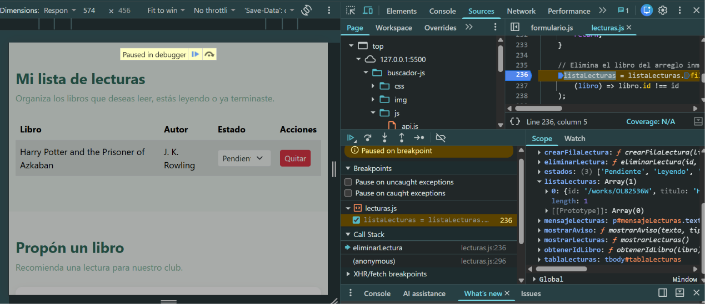
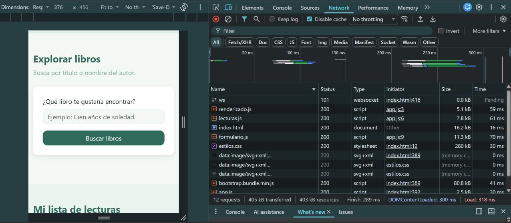
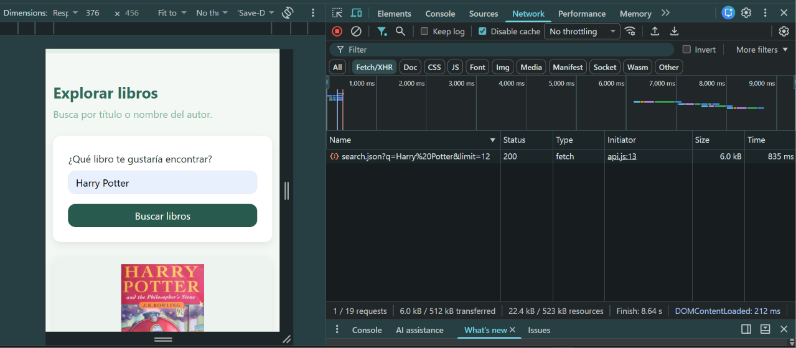
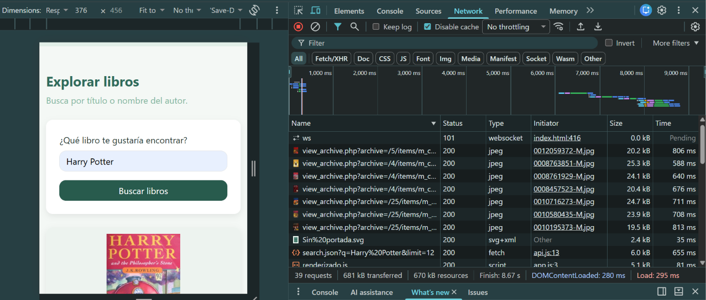
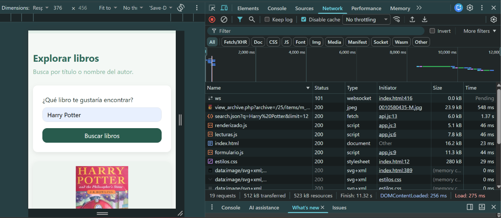

# Documentación de depuración

## 1. Error identificado durante el desarrollo

Durante las pruebas de la lista de lecturas se encontró
un error al eliminar libros.

El navegador mostraba el siguiente mensaje:

`Uncaught ReferenceError: eventoanimationName is not defined`

El error ocurría porque se intentaba utilizar una
variable que no existía.

Para corregirlo, se modificó la condición y se
utilizó correctamente `evento.animationName`.

Después de la corrección, los libros se eliminan
de la lista y vuelve a aparecer el mensaje cuando
no quedan lecturas.

## 2. Depuración con breakpoint

Se utilizó la pestaña Sources de Chrome DevTools
para colocar un breakpoint en la función
`eliminarLectura()` del archivo `lecturas.js`.

El objetivo fue revisar el identificador del libro
y el contenido del arreglo `listaLecturas` antes
de realizar la eliminación.

**Captura del breakpoint:**

## 3. Análisis de Network

Se utilizó la pestaña Network de Chrome DevTools
para revisar las solicitudes y los recursos
descargados por el buscador.

### Carga inicial

- Cantidad de solicitudes: 12
- Tamaño transferido: 405 kB
- Tamaño de recursos: 403 kB
- Tiempo de carga (Load): 287 ms
- DOMContentLoaded: 238 ms
- Condiciones: Disable cache activado y No throttling.

**Captura de Carga Inicial:**

### Búsqueda de libros

### Búsqueda de libros

- Texto utilizado: Harry Potter
- Cantidad total de solicitudes: 19
- Tamaño total transferido: 512 kB
- Tiempo de la solicitud a Open Library: 835 ms
- Tiempo total (Finish): 8.64 segundos
- Estado de la solicitud: 200 (correcto)
- Condiciones: Disable cache activado y No throttling.

**Captura de Network:**

## 4. Optimización de imágenes

Durante el desarrollo del buscador se implementó el atributo
`loading="lazy"` en las imágenes de las portadas.

Esta optimización permite que el navegador posponga la carga
de imágenes que todavía están fuera del área visible.

Para comprobar su funcionamiento, se realizaron dos pruebas
con la búsqueda "Harry Potter": una sin `loading="lazy"`
y otra con el atributo activado.

Ambas pruebas se realizaron en Chrome DevTools, con
Disable cache activado, No throttling y sin desplazarse
por la página.

### Comparación de resultados

| Medición | Sin lazy loading | Con lazy loading |
|---|---|---|
| Solicitudes | 39 | 19 |
| Tamaño transferido | 681 kB | 512 kB |
| Tamaño de recursos | 670 kB | 523 kB |
| Tiempo total (Finish) | 8.67 s | 11.32 s |
| DOMContentLoaded | 280 ms | 256 ms |
| Load | 295 ms | 275 ms |

### Evidencias

**Sin lazy loading:**

**Con lazy loading:**

### Análisis de resultados

Al activar `loading="lazy"`, la cantidad de solicitudes
disminuyó de 39 a 19, lo que representa una reducción
aproximada del 51.3 %.

También disminuyó el tamaño transferido, pasando de
681 kB a 512 kB, es decir, 169 kB menos.

Esto muestra que el navegador evitó descargar inicialmente
varias imágenes que todavía no eran necesarias.

Sin embargo, el tiempo total registrado en Finish aumentó
de 8.67 a 11.32 segundos. Este resultado puede variar
por factores como la conexión y la respuesta del servidor,
por lo que no se puede asegurar que la carga total sea
más rápida a partir de estas dos pruebas.

### Conclusión

Se decidió mantener `loading="lazy"` porque permite
reducir la cantidad de imágenes descargadas inicialmente
y el consumo de datos.

Esta optimización resulta útil para el buscador, ya que
los resultados pueden contener varias portadas que
el usuario todavía no necesita visualizar.